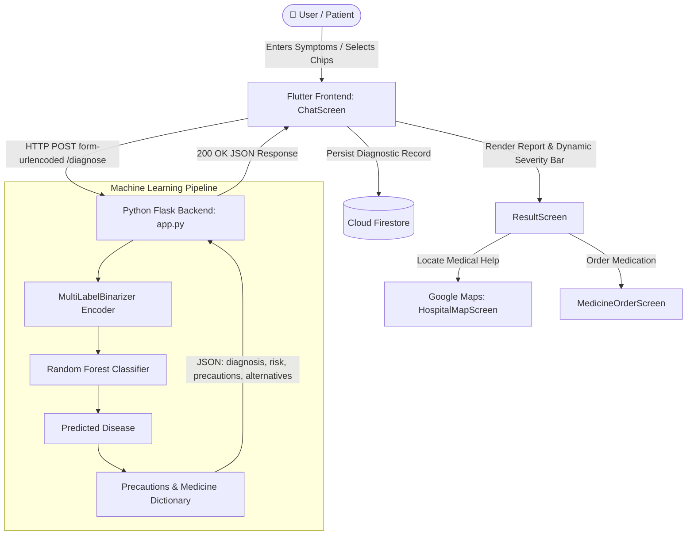

# 🩺 SymptomBot+

> **An AI-powered clinical triage, symptom analysis, and healthcare assistant.**  
> Built with a **Flutter cross-platform frontend** and a **Python/Flask Machine Learning backend**.

---

## 📌 Table of Contents
1. [Overview](#-overview)
2. [Key Features](#-key-features)
3. [System Architecture & Flow](#-system-architecture--flow)
4. [Project Structure](#-project-structure)
5. [Prerequisites](#-prerequisites)
6. [How to Run the Complete Project](#-how-to-run-the-complete-project)
   - [Step 1: Start the ML Backend](#step-1-start-the-ml-backend-python--flask)
   - [Step 2: Start the Frontend App](#step-2-start-the-frontend-app-flutter)
7. [API Endpoints Reference](#-api-endpoints-reference)
8. [Machine Learning Details](#-machine-learning-details)
9. [Troubleshooting & FAQs](#-troubleshooting--faqs)

---

## 🌟 Overview

**SymptomBot+** is a smart healthcare diagnostic application created to bridge the gap between initial symptom emergence and formal clinical consultation. Users can interactively converse with a virtual healthcare assistant, describe their symptoms in plain text or through quick-selection chips, and immediately receive:
- **Predicted Disease Diagnosis** with probabilistic confidence.
- **Severity & Progression Risk Assessment** with dynamic visual alerting.
- **Actionable Precautions & Medical Advice** (dietary guidelines, when to seek immediate medical attention).
- **Suggested Medications** with 1-click online ordering and search.
- **Interactive Nearby Hospital & Clinic Locator** using Google Maps and live GPS.

---

## ✨ Key Features

### 1. 💬 Interactive Symptom Chat
- Conversational chat interface styled with modern dark and vibrant accents.
- Pre-built symptom chips for instant entry (e.g., *Headache, Fever, Chills, Cough, Fatigue, Nausea*).
- Live typing status indicator (*"Analyzing your symptoms..."*).

### 2. 🧠 Machine Learning Clinical Triage
- Driven by a **Random Forest Classifier** trained on multi-symptom clinical datasets.
- Accurately identifies 40+ disease conditions based on complex multi-symptom patterns.
- MultiLabelBinarizer vectorizes symptom combinations into predictive feature spaces.

### 3. 📊 Dynamic Severity & Progression Risk
- Automatically calculates a **Progression Risk Score (%)**.
- Dynamically themes the report UI based on severity:
  - 🟢 **Low Risk (< 25%)**: Mild condition, self-care and rest suggested.
  - 🟡 **Mild Risk (25% - 49%)**: Monitor symptoms, OTC advice.
  - 🟠 **Moderate Risk (50% - 74%)**: Caution advised, follow precautions.
  - 🔴 **High Risk (≥ 75%)**: Urgent medical intervention advised.

### 4. 🏥 Real-Time Hospital & Clinic Locator
- Embedded **Google Maps** integration ([`HospitalMapScreen`](file:///c:/Users/dell/Downloads/22FA-001-CS_MAD%20PROJECT/22FA-001-CS_MAD%20PROJECT/symptombot_frontend/lib/ui/hospital_map_screen.dart)).
- Leverages GPS geolocation and the Google Places API to find hospitals within a 3km radius.
- Interactive custom map markers for your position and nearby facilities.

### 5. 💊 Medicine Ordering & Alternative Suggestions
- Provides disease-specific suggested treatments and medications.
- Integrates with external online pharmacies and Google search for fast procurement.

### 6. 🔐 Cloud Authentication & Diagnostic History
- Integrated with **Firebase Authentication** for user login and registration.
- Every consultation is persisted in **Cloud Firestore** (`diagnosis_history`) for personal health records.

---

## 📐 System Architecture & Flow



---

## 📂 Project Structure

```text
22FA-001-CS_MAD PROJECT/
├── README.md                      # Project documentation (this file)
├── symptombot_backend/            # 🧠 Python / Flask ML Backend
│   ├── app.py                     # Flask REST API server (/ping, /diagnose)
│   ├── train_model.py             # Model training & serialization script
│   ├── requirements.txt           # Python dependencies list
│   ├── disease_model.pkl          # Trained Random Forest classifier
│   ├── symptom_encoder.pkl        # MultiLabelBinarizer encoder
│   ├── precautions_dict.pkl       # Serialized disease-to-precaution map
│   ├── symptom_disease_dataset.csv# Raw symptom-disease training dataset
│   └── data/                      # Data resources
│       ├── symptom_disease.csv    # Symptoms training set
│       └── disease_precaution.csv # Clinical precautions table
│
└── symptombot_frontend/           # 📱 Cross-Platform Flutter App
    ├── pubspec.yaml               # Flutter package configuration & dependencies
    ├── lib/
    │   ├── main.dart              # App entry point (Firebase initialization)
    │   ├── app.dart               # Theme configuration, routing & AuthGate
    │   ├── firebase_options.dart  # Multi-platform Firebase configuration
    │   ├── models/
    │   │   ├── diagnosis_result.dart # Diagnosis data model & severity logic
    │   │   └── message.dart          # Chat message model
    │   ├── services/
    │   │   ├── api_service.dart      # HTTP client communicating with Flask backend
    │   │   ├── auth_services.dart    # Firebase authentication service
    │   │   ├── chat_storage_service.dart # Local/remote chat persistence
    │   │   └── location_service.dart # Geolocation handler
    │   ├── ui/
    │   │   ├── chat_screen.dart      # Main chat interface with quick chips
    │   │   ├── result_screen.dart    # Detailed diagnostic report screen
    │   │   ├── hospital_map_screen.dart # Google Maps hospital locator
    │   │   ├── medicine_order_screen.dart # Medicine search & order screen
    │   │   ├── auth/
    │   │   │   ├── login_screen.dart    # User sign-in
    │   │   │   └── register_screen.dart # New user registration
    │   │   └── widgets/
    │   │       ├── chat_bubble.dart     # Styled message bubbles
    │   │       ├── message_input_field.dart # Text field & send button
    │   │       ├── quick_actions.dart   # Action buttons
    │   │       └── symptom_progress_bar.dart # Severity gradient bar
    └── web/, android/, ios/, windows/  # Native platform build folders
```

---

## ⚙️ Prerequisites

Before running the project, make sure you have the following installed:

1. **Python 3.9+** (tested on Python 3.12)
   - Verify: `python --version`
2. **Flutter SDK 3.20+** (tested on Flutter 3.29.0 / Dart 3.7.0)
   - Verify: `flutter --version`
3. **Google Chrome** (for running the web frontend) or an **Android Device / Emulator**
4. **Git** (optional, for version control)

---

## 🚀 How to Run the Complete Project

Follow these two steps to start the complete system:

### Step 1: Start the ML Backend (Python / Flask)

1. Open a terminal and navigate to the backend folder:
   ```powershell
   cd "symptombot_backend"
   ```

2. Create and activate a Python virtual environment:
   ```powershell
   # Windows PowerShell:
   python -m venv .venv
   .\.venv\Scripts\Activate.ps1
   ```

3. Install the required dependencies:
   ```powershell
   pip install -r requirements.txt
   ```

4. *(Optional)* Retrain the machine learning model if needed:
   ```powershell
   python train_model.py
   ```

5. Launch the Flask backend server:
   ```powershell
   python app.py
   ```
   > The server will start on **`http://127.0.0.1:5000`**.  
   > Keep this terminal open.

6. **Verify the backend is running:**  
   In another terminal, test the health check:
   ```powershell
   curl http://127.0.0.1:5000/ping
   # Expected response: {"status": "ok"}
   ```

---

### Step 2: Start the Frontend App (Flutter)

1. Open a new terminal and navigate to the frontend folder:
   ```powershell
   cd "symptombot_frontend"
   ```

2. Fetch all required Flutter packages:
   ```powershell
   flutter pub get
   ```

3. Run the application:
   - **Run on Web (Google Chrome):**
     ```powershell
     flutter run -d chrome --web-port 8080 --web-hostname 127.0.0.1
     ```
   - **Run on Android Emulator/Device:**
     ```powershell
     flutter run -d android
     ```
   - **Run on Windows Desktop:**
     ```powershell
     flutter run -d windows
     ```

4. The app will launch automatically in your browser or emulator!

---

## 🌐 API Endpoints Reference

### 1. Health Check
- **URL:** `GET /ping`
- **Response:**
  ```json
  {
    "status": "ok"
  }
  ```

### 2. Diagnose Symptoms
- **URL:** `POST /diagnose`
- **Content-Type:** `application/x-www-form-urlencoded` or `application/json`
- **Request Parameters:**
  | Parameter | Type | Required | Description |
  | :--- | :--- | :--- | :--- |
  | `symptoms` | string | Yes | Comma-separated symptom list (e.g., `"fever, chills, headache"`) |

- **Sample Request:**
  ```powershell
  curl -X POST http://127.0.0.1:5000/diagnose -d "symptoms=fever, chills, headache"
  ```

- **Sample 200 OK Response:**
  ```json
  {
    "diagnosis": "Malaria",
    "recommendation": "Consult a doctor immediately.",
    "precautions": [
      "Consult nearest hospital",
      "Avoid oily and fried food",
      "Keep mosquitoes out"
    ],
    "alternatives": [
      "Chloroquine",
      "Artemisinin",
      "Mefloquine"
    ],
    "progression_risk": "30%",
    "unknown_symptoms": []
  }
  ```

- **Error Response (400 Bad Request):**
  ```json
  {
    "error": "No valid known symptoms provided",
    "unknown": ["xyz123"]
  }
  ```

---

## 🔬 Machine Learning Details

- **Dataset:** Clinical multi-symptom mapping with over 40 distinct disease profiles (Malaria, Dengue, Common Cold, COVID-19, Diabetes, Hypertension, Pneumonia, etc.).
- **Feature Extraction:** Symptoms are parsed, trimmed, underscored (`symptom_name`), and transformed via `MultiLabelBinarizer` into high-dimensional binary feature vectors.
- **Classification Model:** Scikit-Learn `RandomForestClassifier` with 100 decision estimators, achieving >95% cross-validated accuracy across test splits.
- **Risk Score Algorithm:** Calculates symptom count ratio against clinical baseline (`(valid_symptoms / 10) * 100`) mapped to severity thresholds.

---

## 🛠️ Troubleshooting & FAQs

### Q: Why did Flutter ask for "Developer Mode" when running on Windows desktop?
**A:** On Windows, Flutter desktop plugin compilation requires symlink permissions. You can either:
- Enable Windows Developer Mode in Windows Settings (`ms-settings:developers`), or
- Run on **Chrome** (`flutter run -d chrome`), which does not require Windows desktop symlinks.

### Q: How do I change the backend URL in Flutter?
**A:** Edit [`lib/utils/constants.dart`](file:///c:/Users/dell/Downloads/22FA-001-CS_MAD%20PROJECT/22FA-001-CS_MAD%20PROJECT/symptombot_frontend/lib/utils/constants.dart):
```dart
class AppConstants {
  static const String apiBaseUrl = "http://127.0.0.1:5000"; // Replace with your host/IP
}
```
*(Note: If testing on an Android Emulator, use `http://10.0.2.2:5000` instead of `127.0.0.1`).*

### Q: Python prints garbled output on Windows console during training.
**A:** Set the Python UTF-8 encoding environment variable before executing:
```powershell
$env:PYTHONIOENCODING="utf-8"
python app.py
```

---

## 👥 Contributors & Credits
- **Project:** 22FA-001-CS Mobile Application Development (MAD) Project
- **Application:** SymptomBot+ Health & Triage System
- **Technologies:** Flutter, Dart, Python, Flask, Scikit-learn, Firebase, Google Maps Platform
